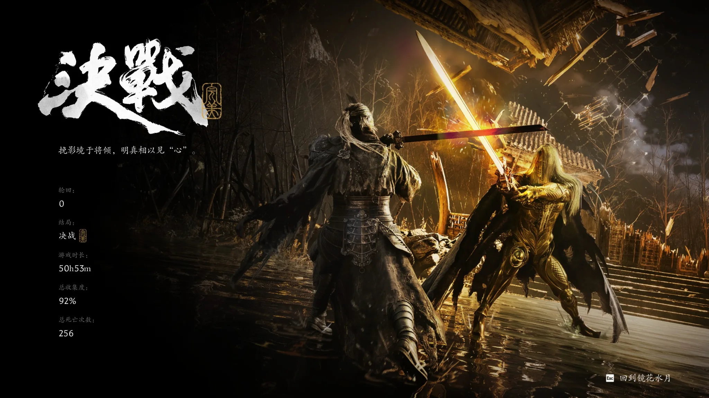

本文含剧情及Boss战剧透。

通关《影之刃零》之后，我对它的整体感受，有点像爬一座山。

一开始你一直在往上爬，风景越来越好看，手里的能力越来越强，能玩的东西也越来越多。然后你爬上了一片高原。这里的风景已经够美了，地方也够大，但游戏让你在这片高原上又走了二十个小时。

你知道它很难再往上走了，可也得承认，它一直保持着很不错的水准。只是走到最后，人难免有点累。这大概就是我对这款游戏最复杂的感受。

它是真的量大管饱。50个小时，92%的探索度，成就也差不多全了，结果我还是能翻出没做完的支线。每次我觉得快到结局了，游戏就告诉我：前面还有一大片江湖呢。

不过比起内容量，我更想聊的是它对传统动作游戏的改造。它想回答的问题是：一个不太会玩动作游戏的普通玩家，能不能也体验到当顶尖高手的爽感？

我觉得它做到了。

## 一、所谓魂游，就是魂大人的游乐场

首先，我动作游戏玩得并不好。

《只狼》玩了72个小时还没通关，到现在还卡在苇名一心，中间也没少SL。《忍者龙剑传》《猎天使魔女》《合金装备崛起：复仇》这些高速ACT我都久仰大名，但一直算不上这类游戏的玩家。

刚开始上手《影之刃零》的时候，我一度以为这又是一款魂游，所以打得极为有压力。

尤其是前几张地图：敌人出招有红光蓝光提示，你得熟悉闪避、格挡的键位，还得在陌生的地图里摸清敌人是怎么配置的。前期装备少，回血资源也紧，很自然就会用《只狼》的思路去玩：先观察，学招，找破绽，再小心翼翼地还手。

第一章暗魔天堡之主魔渊那一战，更是加深了这个印象。这个由甄子丹扮演的Boss，基本就是一堂高强度的红蓝光教学课。你得一边看他出招，一边练闪避和弹反的时机，在一招一式之间找机会反击。我在逆天者难度下跟他打了十多回合，觉得该学的差不多都学会了，就干脆降难度过了。

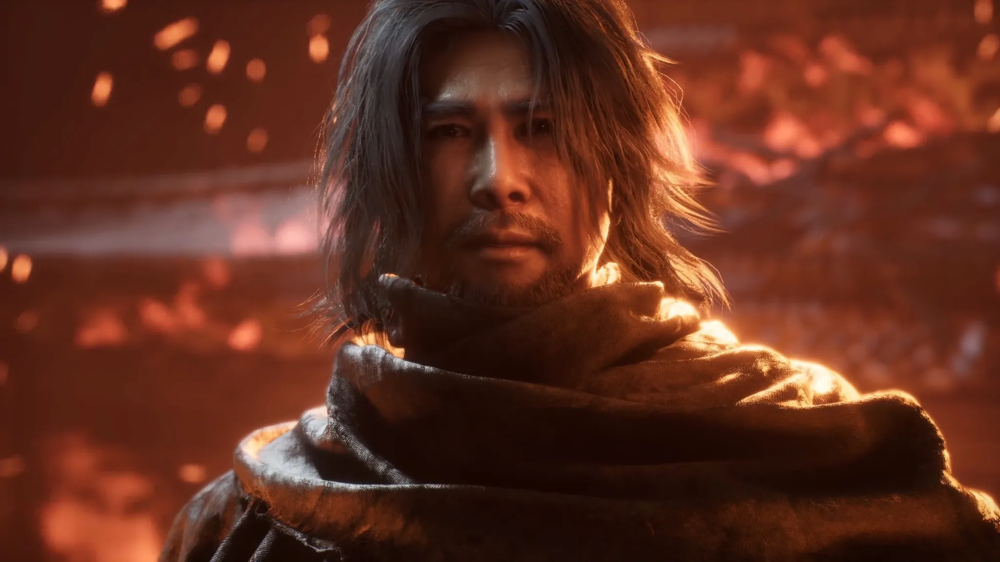

另一个印象很深的前期Boss是新娘阿花，那会儿手里资源不多，build也没成型，莫名其妙就到了这个支线Boss跟前。只能老老实实研究她的招式。结果偏偏她又是放地雷，又是放弹幕，还在一片红色里放红光投机，给人打得没脾气。很自然，她后来也成了玩家社区里流传很广的梗。

但到了陆家村中后期，尤其是进了庞镇之后，我慢慢发现：这游戏好像也没那么难？

武器、饰品、药瓶、影之武装一样样解锁，能用的战术一下子多了起来。两把主武器、两个影之武装、两种药瓶、六个饰品槽，再加上各种装备的成长线，一套挺完整的动作RPG构筑系统就这么摆在了眼前。

以前打Boss，我想的是：他这招我该怎么接？

后来想的变成了：这把武器不顺手，换一把试试？这个护符效果这么夸张，带上看看？这个影之武装好像正好克他的机制？

一开始我以为自己得照着游戏的规矩来，后来才发现，规矩可以我自己定。

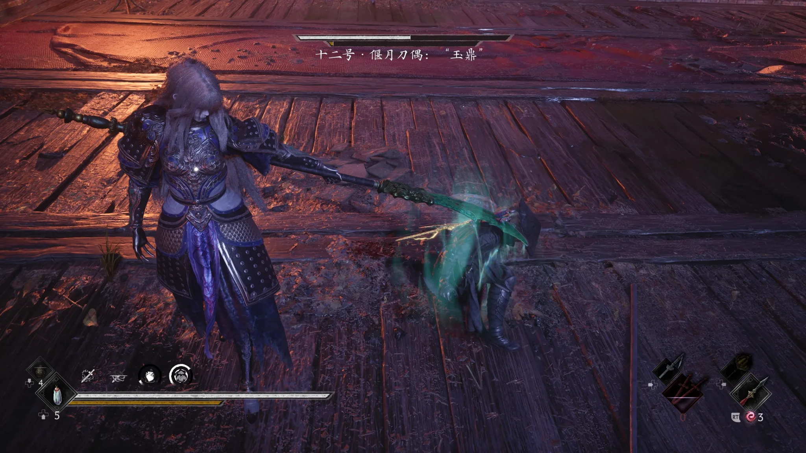

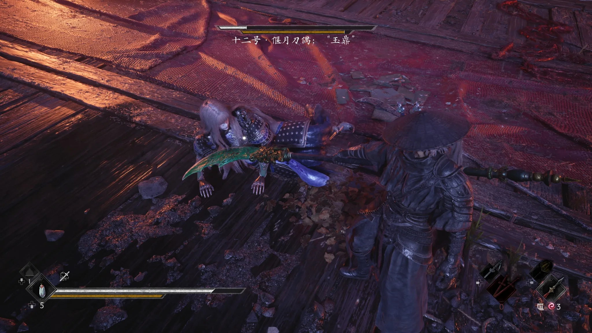

这是我觉得《影之刃零》最有意思的地方。它在高速ACT的底子上，做了一套很好玩的RPG构筑。很多饰品都是有得有失的，比如低杀气时增伤、强化某种杀气连招，或者根据血量给不同程度的减伤。这些设计会推着你去改自己的打法，流派也就多了起来。

我自己就是个很典型的例子。前期我打得特别保守，饰品槽几乎全堆了生存：减伤、回血、容错，能带的辅助和保命饰品基本都带上了。打Boss的思路就是先活下来，等他露破绽。标准的乌龟流。

后来我发现那些攻击饰品的效果实在太离谱了。既然有这么多办法堆输出，我干嘛一直缩在龟壳里？

于是我开始琢磨新build，围绕舞扇的攻击位移增伤，再配上残破容器这些饰品，搓了一套很激进的进攻流。原来的生存流就慢慢不用了。我开始主动压上去，靠位移找输出机会，再靠装备的各种收益把节奏撑住。最后陪我打到结局的，就是这套攻击流。

这种成长挺有意思的。我自己的操作当然有进步，但构筑带来的变化一点不比它小。

到了中期，特别是饰品能升级之后，角色数值又爆了一波，整个游戏的气质也跟着变了：从一个被Boss虐、得小心防守反击的游戏，变成了一场想怎么打就怎么打的武术表演。我终于有了点十八般武艺样样精通的感觉。

这时候我才反应过来，所谓魂游，原来是魂大人的游乐场。

## 二、百般武艺，个个都是轮椅

《影之刃零》的战斗深度到底有多深？这个问题挺难回答的。

武器、技能、特殊机制、构筑组合都不少，理论上能研究的东西很多。但它好像也没打算逼玩家把这些系统吃透。你完全可以挑一套顺手的武器，配几个强力饰品，然后一路乱按，照样打得很漂亮。

这不一定是坏事。传统高速ACT更看重玩家自己的技术，你得一遍遍练、熟悉操作，才能打出那些眼花缭乱的连招。《影之刃零》则是把一部分技术成长换成了角色成长，让更多人靠配装和养成，也能打出高速ACT的那种观赏性。现在游戏直播和视频这么发达，游戏看起来够帅，本身就很重要。

而《影之刃零》最不缺的就是帅。非要用三个词概括它的战斗，我会说：帅、酷、装逼。

更好玩的是，不同武器确实各有各的强项。社区里甚至吵出了一股江湖味：到底哪把才是最强的「轮椅」？每个门派都觉得自己天下第一，谁也不服谁。还真有点江湖那意思了。

我第一次真正感受到「轮椅」的威力，是第二章中期拿到的亡命斩马刀。刚拿到的时候没太当回事，后来发现它能吸血，还能跟活木符这类饰品联动，连人偶身上都能吸。这就有点不讲道理了。我拿着它回陆家村，之前打得提心吊胆的战斗一下子轻松了不少。

除了主武器，副武器的挑选也有许多可以说道的。比如「雷枪」长鸿的雷霆枪。我一开始一直觉得这玩意儿花里胡哨的，肯定没我的烈焰狮头和妙手飞刀好用。直到有天在视频里看到别人用它打出夸张的连击数，一套连招六千段？我赶紧回游戏里换上试了一下。

卧槽，这也太强了。

这种事在游戏里反复发生。很多武器一开始看着不起眼，认真研究一下才发现都有很离谱的地方。所以你会一直想换新流派玩，武器之间的争论也就特别有意思。

我自己是坚定的乱莺剑党。这把沐小葵给我的剑几乎陪了我一整趟旅程，打到最终决战都没离开过武器栏。另外我也很喜欢白山风雷剑，虽然它在我手里好像没想象中那么强。白影也是我很爱的一把，动作帅，还能把敌人冻住。黑魔伤、炽刃、妖锯，也都是我最后砸了大量资源升级的武器。

至于破军？玩破军的都是蠢××。

然后我就在荒行子那场Boss战里，拿着破军跟他对冲，打出了整个游戏里最爽的几次交手。

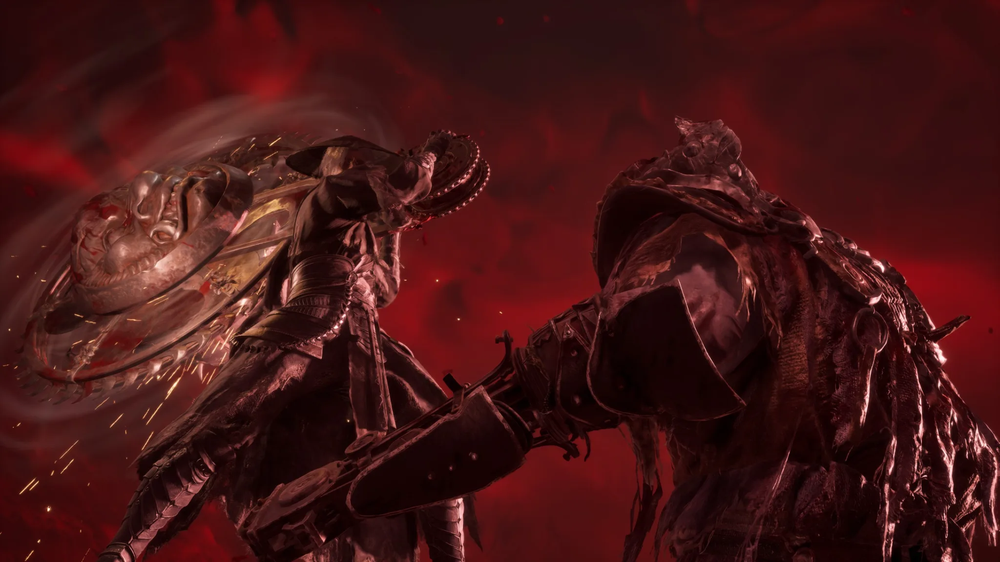

好吧，破军确实有点东西。这也是我喜欢这套武器系统的原因：一把你平时看不上的武器，可能在某场仗里突然让你get到它的好。

打败左殇之后拿到的紫冥剑，又把演出效果拉到了另一个极端。处决动画夸张到我一瞬间以为自己在玩《最终幻想16》。这还是人类的武侠世界吗？但它确实帅得让人没法拒绝。

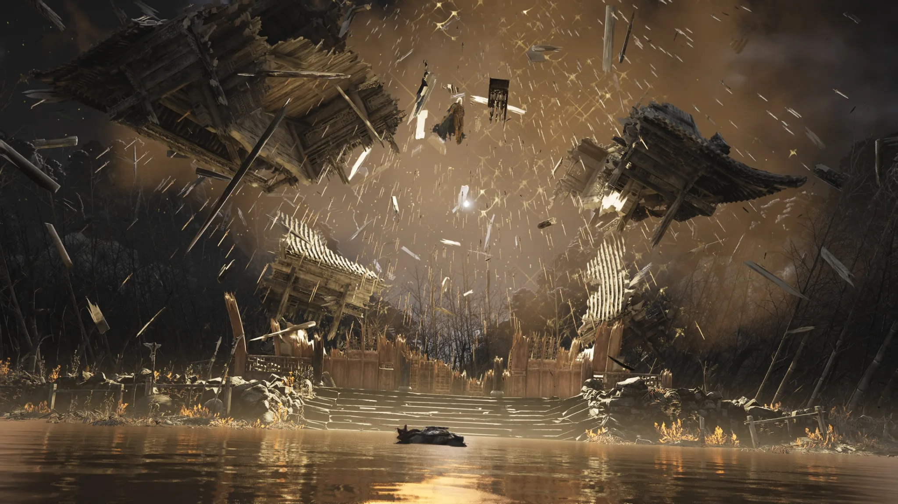

## 三、当每场胜利都变成理所当然

不过，战斗系统做得成功，也带来了这款游戏最大的遗憾：角色越来越强，难度慢慢跟不上了。

中期这个变化是很让人兴奋的。我到现在还记得，自己在逆天者难度下，顶着电脑疯狂掉帧，初见过了沐小葵的三阶段Boss战。那一下我真觉得自己是个天才。

沐小葵也是我心里整部游戏设计得最好的Boss之一。三个阶段各有各的武学特色，跟她的性格和人物关系也贴得很紧。最后对上玉妖和铁鬼两个护卫，又给战斗加了新花样。有演出，有挑战，也有高手过招的感觉。

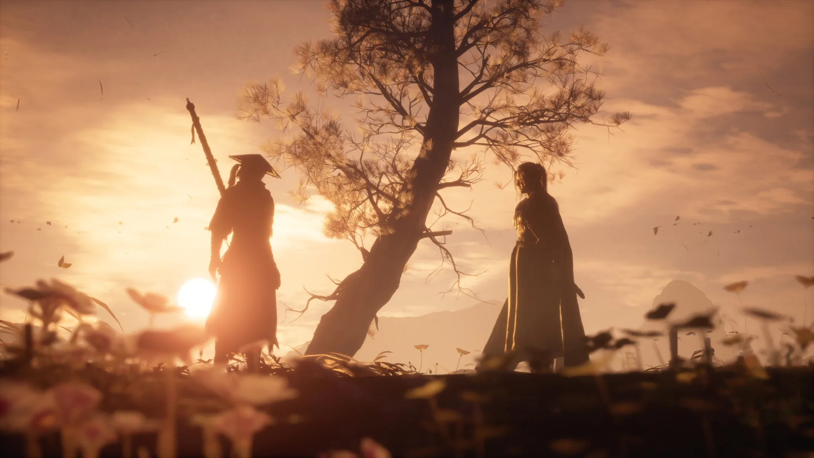

鬼差那几场Boss我也很喜欢。庞镇的鬼差队长火流星，还有分布在庞镇和梅谷湖的三个鬼差高手斩骑、勾魂、断肠，都让我印象很深。尤其那几个鬼差高手，节奏特别爽，双方一直在高速攻防，你来我往很有武侠味，难度也刚刚好。

我碰到他们的时候，正好是难度曲线开始变的阶段：角色已经有点本事了，但还没强到能直接碾过去。这些人形Boss我基本一两次就能过，但过程依然够刺激。

这可能是我最喜欢的《影之刃零》战斗体验。你已经能主动进攻、打出好看的招式，但也得认真应对对方的攻击。一招一式地过，赢了有成就感，又不至于因为反复死而心累。我觉得武侠切磋的乐趣就在这里。

剑痴花千笑也很有代表性。醉剑的动作飘逸，战斗节奏跟人物形象很搭，招式设计有老武侠片的味道。我尤其喜欢他的面具，还有那场战斗整体的美术风格。

不过这场战斗有个比较明显的问题，有些攻击的可读性不太好。部分招式的判定不直观，你很难判断自己到底被打没打中，偶尔莫名其妙掉一大截血，挺让人困惑的。动作演出再华丽，也得有清楚的战斗反馈配合，不然很容易被这些漂亮的招式晃花眼。

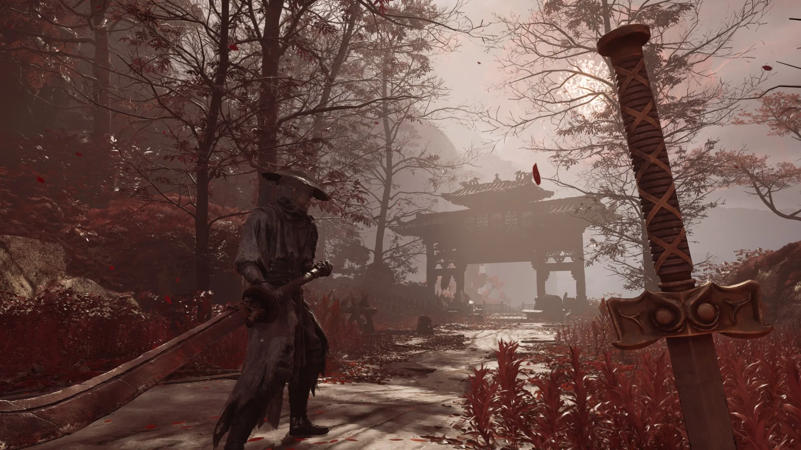

魔渊的动作也值得夸。甄子丹和甄家班参与了动捕和武打设计，他的招式确实很有动作片的气质，很多动作的衔接、发力和节奏，都能看出专业武术表演的底子。可惜后期数值一路膨胀，这些原本很有压迫感的招式，也就慢慢没什么挑战性了。

游戏越往后推，越来越多看着招式华丽、气势吓人的Boss，被我一两次就打掉了。最开始初见过Boss让我很惊喜，后来初见过就成了理所当然的事。

Boss看起来很强，和Boss真的能威胁到你，是两回事。《影之刃零》在前者上几乎做到了顶，很多Boss的招式、动作和演出都很有压迫感。但我手里的武器和build实在太强了。不管对面演得多吓人，我慢慢都会相信，自己有的是办法把他轻松拿下。

这让我想起以前玩过的一些二次元养成手游。游戏用特别夸张的演出告诉你：眼前这个敌人极其危险，接下来是一场生死恶战。我看着自己手里90级满配的豪华阵容，只想问一句：你再强，打得过我的黄金大队吗？

《影之刃零》后期有时就是这种感觉。新Boss登场，动作帅得离谱，攻击范围大得吓人。但仔细一想，我手里的乱莺剑还是那把乱莺剑，输出手法也没怎么变。躲红光，躲蓝光，继续输出，他迟早得死。结果还真就是这样。

连魔渊也是。第一章我反复挑战了十几次、一直在练红蓝光的这个Boss，后面剧情里还登场了好几次，但随着装备和数值上去，他已经给不了最初那种压迫感了。

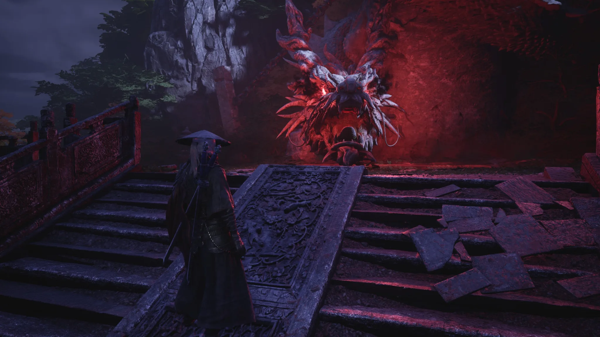

当然，我也不觉得所有Boss都该很难。比如火流星那一战，玉儿遇害之后，我要的恰恰就是一场痛快的复仇。那种接近《战神》的暴力处决让我非常满足，初见就过反而更解气。但当大部分Boss都没法持续带来挑战时，成就感难免会一点点被磨掉。

更遗憾的是，少数真正卡住我的Boss，体验反而不一定更好。比如一些幻术师类的敌人，得等他放特定招式，再靠反弹才能打出有效伤害。你明明知道该怎么打，也知道该用什么办法，但整个过程就是很难受。这种战斗把之前好不容易建立起来的自由给收回去了，反而让我更怀念那些能正面硬碰的人形Boss。

顺带一提，游戏里的多阶段Boss，失败后可以直接从后面的阶段重开。我能理解这是为了降低挫败感，也符合它想照顾更多玩家的定位。但如果高难度下能给一个必须一口气打完所有阶段的选项，想要完整决斗感的玩家应该会更满足。

不过，后期难度调高了游戏就一定更好吗？我也说不准。如果只是给Boss加血加攻，大概只会让战斗更拖。比较理想的做法，可能是让敌人的机制跟着玩家越来越强的build一起成长。

说到这儿我自己也有点矛盾。一个坏事做尽的反派终于站到面前，我当然希望他够有压迫感，让我体会一下战胜强敌的成就感。可转念一想，我扮演的本来就是武林高手，都练成一身绝世武功了，痛痛快快把这些反派打趴下，好像也挺合理。

既想让敌人强，又想让自己更强。我到底想要哪种体验？说实话，我自己也说不太清楚。

## 四、魂系的地图，银河城的探索

如果说战斗是《影之刃零》最直观的魅力，那探索就是我觉得它做得最聪明的地方之一。

它从魂系那里拿来了互相连通的箱庭地图、复杂的捷径，还有靠一点点摸索慢慢搞懂一整片区域的乐趣。同时又借了银河恶魔城那套能力解锁。很多影之武装除了打架，还能开机关、找隐藏路线，甚至解锁新区域。武器同时也是探索世界的钥匙。

不过这套设计还有改进的空间。我印象最深的是第二章血色森林飞贼营地的密道。那里有一处机关弩箭，得用盾牌才能过去。我拿到拙壁盾之后，很自然地就想打开盾牌去挡箭。

结果挡不住。

尝试几次后发现，必须站在游戏指定的位置，按提示按RT，才会触发正确的挡箭动作。这就有点离谱了。盾牌本来就能防御，战斗里能随便用的动作，怎么到了探索场景就突然不灵了？说到底还是探索能力和战斗能力没真正打通。你以为拿到了一个能灵活用的工具，实际上只能在固定的地方触发预设好的交互。

但总的来说，《影之刃零》的地图设计还是很优秀的。

尤其是正道大营，我认为是整个游戏设计得最好的一张地图。庞镇虽然大、内容多，但有时候会显得有点太空旷。正道大营在地图大小、探索密度、大循环小循环的安排上平衡得更好。那种一路绕、一路开捷径，最后发现自己又绕回了熟悉地方的感觉，让我找回了当年跑《只狼》地图时的兴奋。山重水复疑无路，柳暗花明又一村。

正道大营的Boss也做得很好。七星剑阵很有传统武侠的味道，游戏还会根据你之前战斗中的选择，改变后面的战斗和剧情。

《影之刃零》在地图探索中做了一个很重要的改动：游戏里的道中普通敌人不会因为你在存档点休息而刷新。这是一个牵一发而动全身的修改。

一方面，这削弱了传统魂系地图靠重复配敌制造的资源压力，符合游戏降低门槛的目的。另一方面，这也让击杀敌人获得的资源成为了全局固定的资源。这导致游戏不得不为了考虑一部分不击杀敌人的玩家的收益，在游戏中后期放置大量可收集的资源。而这让愿意清怪的玩家，在中后期完全没有任何资源压力。说到这里，突然想到游戏的“买卖货物”一栏的“贩卖货物”功能估计完全没有玩家用过。因为前期资源紧张，不舍得卖，后期资源溢出，没必要卖。

同时，也改变了捷径的作用。除了给玩家一种回到一个意想不到的地方，豁然开朗的感受，或者引导玩家回到该去的地方之外。有些捷径因此显得没那么必要，我甚至会怀疑它们是不是只是沿用了魂系关卡设计的习惯。

但反过来说，这也省掉了在漫长流程里一遍遍清同一批小怪的疲劳，让游戏的杂兵战的保鲜期被明显拉长。对一款更鼓励探索、又不想让玩家被反复战斗折磨的游戏来说，这个取舍挺合理的。它还让探索有种一直在往前推的感觉：清过的地方终于安全了，这片地盘是我的了。

所以在这一块，我觉得它的改造是成功的：保留了魂系箱庭地图的探索乐趣，又按自己的战斗节奏和玩家定位，把惩罚机制重新调了一遍。

## 五、量大管饱，饱到我以为游戏永远不会结束

我对这游戏的流程长度误判过好几次。

第一次是在庞镇。那时候已经开了一大堆区域，重要任务也做了不少。尤其打开青蛇屋通往戏梦山庄的密道时，游戏还郑重其事地警告我，贸然继续往前可能会有不可挽回的后果。我以为要进结局了，于是先回头把正道大营、梅谷湖等区域和重要Boss都清了一遍。

等终于进了戏梦山庄，我又一次确信：这下总该完了吧？

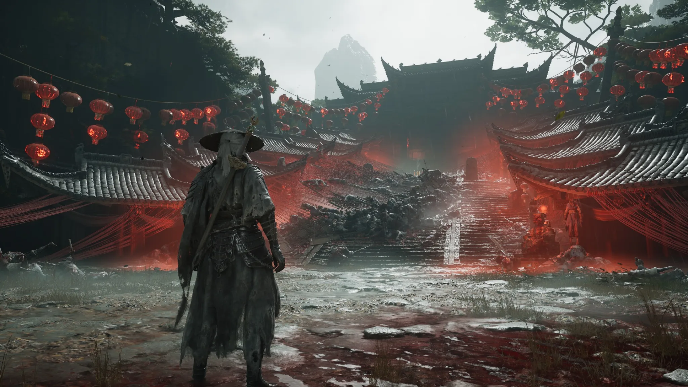

结果戏梦山庄又是一整张独立地图，几乎和庞镇其他区域差不多大。等到打完戏梦山庄，后面还有断魂山。更夸张的是，游戏还会改变第二章已经探索过的地图，让熟悉的区域变个样，再把你引回去重新探索。

我的天，这游戏到底还有多少东西？

我很喜欢B站UP主瓶子君152拿东北大盘菜形容这游戏的说法：你点了一盘三十块的菜，本来还觉得不便宜，结果端上来一看，两个人吃两顿都吃不完。你还能说什么呢？

游戏媒体普遍反映这游戏一周目大概要40个小时，我自己打了50个小时。而且这个时长基本没有水分。一来，大部分Boss到了中后期都能一遍过，不用在同一个Boss身上耗很久；二来，小怪不会刷新，探索也偏一次性，清过的地方基本不用再回去反复跑。

所以它的时长没法直接拿去跟《艾尔登法环》《只狼》《黑暗之魂》这些魂游横向比。那些游戏里，有相当一部分时间是花在反复挑战Boss、一遍遍跑同一条路上的。《影之刃零》靠八张地图实打实撑起了四十个小时左右的流程，这份诚意真的没得挑。就冲这一点，我还是得再说一遍：这游戏是真的量大管饱。

但内容多，不代表体验一直新鲜。《影之刃零》的问题在于，它在中期就把战斗体验推到了很高的水准，之后又让你在这个水准上玩了很久。新武器、新Boss、新流派还在不停地来，但已经很难像中期那样，一次次刷新我对整个战斗系统的理解了。

这就是我开头说的高原：质量一直在线，但体验的增长慢慢平了。

不过这种疲劳主要是在战斗上。地图、人物和美术，在漫长的后半程里还是会不断给我新的惊喜。

## 六、武侠朋克：一个美丽、诡异又残酷的江湖

《影之刃零》的世界观是我很喜欢的另一部分。传统武侠、机关科技、人体异化、神秘术法和超自然力量混在一起，弄出了一种很有特色的武侠朋克风格。

杀气改造就像赛博朋克里的义体改造。一开始只是有些人拿改造来强化自己，其他势力为了不在武力竞争里被淘汰，也只能跟着卷进去。但力量是有代价的，肉体越来越强的同时，人也可能慢慢丢掉原本的心性。

移魂之术又带来另一种恐怖感：人的意识可以被转移到人偶里。传统武侠里对力量的追求，到这里就带上了一股科幻恐怖的味道。

从陆家村的人偶，庞镇的昏睡病，到风雪刀客的悲剧，再到圣母娘娘和表里武林的设定，游戏一点点展示出一个比门派争斗大得多的世界。

尤其是陆家村，这里的中式恐怖氛围我觉得做得特别好。有个场景，我进屋后看到一群人偶安安静静地围坐着，有的看着我，有的看着前方，明明有血条，但都不攻击我，安静得出奇。继续往前走，可以看见一些跟婚礼有关的布置，还有一份读物，打开后四个大字：「洞房花烛」。我这才反应过来：这群人偶好像在参加一场婚礼。

那种恐怖感真的很难形容。没有Jump Scare，也没有突然贴脸的怪物，就是一些熟悉的民俗符号，在诡异的环境里被扭曲了一下，再加上阴森的光影，让人后背发凉。圣母娘娘那些跟生育、母性有关的怪诞形象，也把这种反差用得很好。

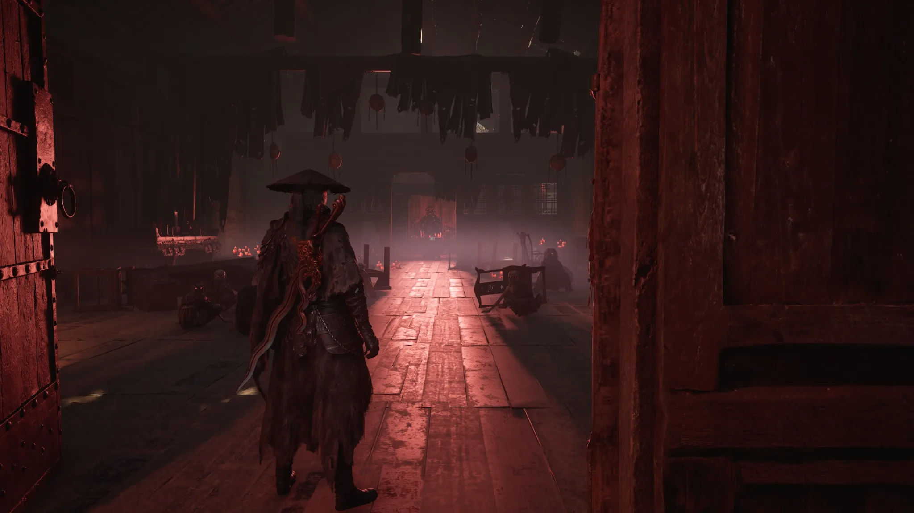

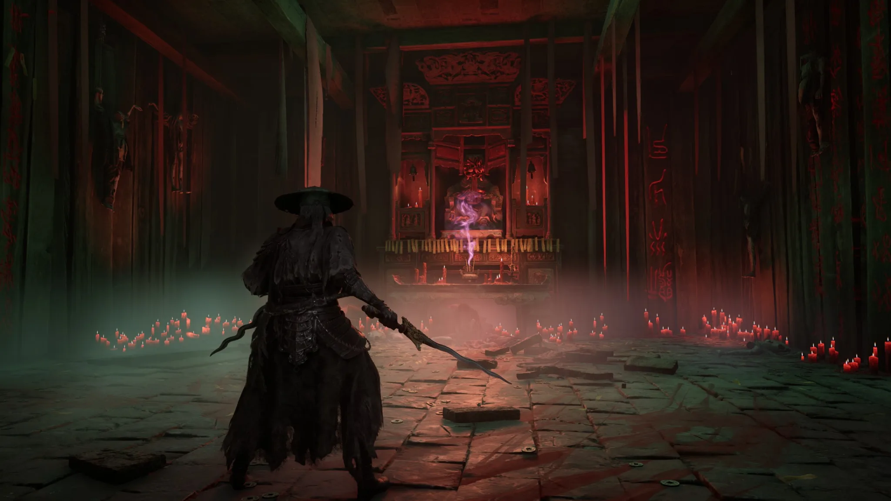

随着剧情往下走，表里武林、浊、圣母娘娘、观星仪这些设定又把世界观往更神秘的方向推，甚至让我联想到克苏鲁式的宇宙恐怖。这些东西本作不一定都讲清楚了，但确实让我对这个世界很感兴趣。

相比之下，它的纯技术表现不算行业顶尖。部分人物的面部表现、材质细节和过场动画还有明显的提升空间。许多演出甚至给我一种整体被调成1.3倍速的怪异感，动作之间少了该有的停顿，反而没了力量感。

但它的美术是真的好。诡异的人偶、巨大的面具、工业化的机关、古典建筑和各种奇观式的场景，视觉风格非常鲜明。我一路截了一百多张图，很多拿出来直接就能当壁纸。

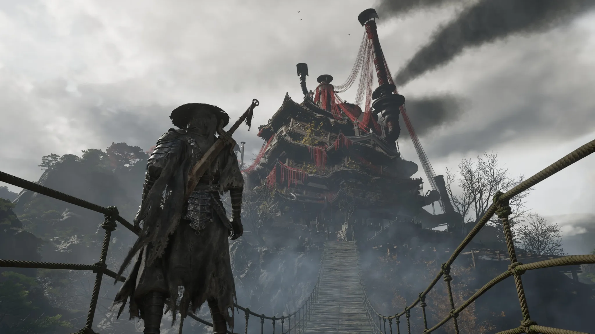

音乐又把这种武侠朋克的气质往上推了一层。传统中国音乐混进金属、摇滚、Trap和电子音色，既有江湖的古典味，又有一股很现代、很暴烈的劲儿。

剑痴花千笑的形象让我印象特别深。他的面具远看有点像《看门狗》或者《收获日》里那种带荧光的现代面具，配上战斗演出和音乐，简直帅得离谱。有些Boss转阶段的时候音乐会突然爆发，那感觉只能用两个字形容：炸了。

还有不得不提人面榕树的入场动画效果，这种转入黑白水墨画风，再配上呼麦的音乐，简直给人听得血脉觉醒，杀气爆发了。

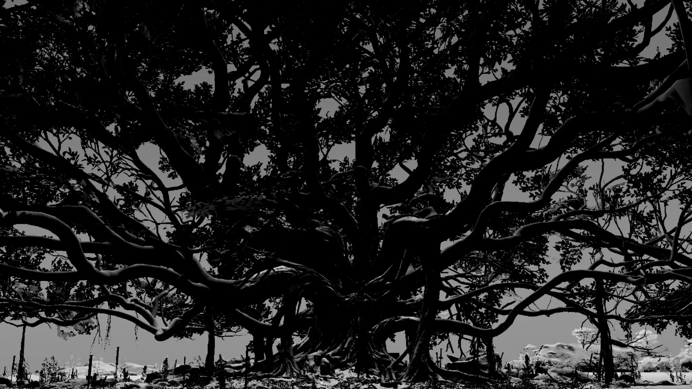

另外，我也很喜欢戏梦山庄用皮影戏讲故事的那段演出。虽然有人觉得太长，但我挺欣赏制作组愿意用真正的传统表演艺术来讲一段故事，这也让《影之刃零》的文化气质更鲜明了。看完这段演出时，我忍不住鼓起了掌。

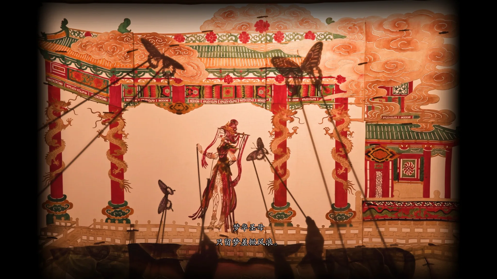

# 七、一个普通的故事，和很多让人忘不掉的人

单看主线剧本，我觉得《影之刃零》其实挺普通的。这是一个时代感很重的武侠故事：阴谋、背叛、组织内斗、兄弟反目，一个被迫背锅的主角，在有限的生命里想查清真相、阻止灾难。框架不复杂，很多剧情走向也不怎么意外。

游戏用了大量碎片化叙事，靠特殊存档点的回忆、龙柱动画、记忆之花和各种文本资料，让你一点点拼出事情的全貌。这让我想到《死亡搁浅》里靠BB的连接播放片段试的回忆慢慢揭开往事的设计。

但《影之刃零》的主线故事本身撑不起这么多文本。有些记忆之花反复解释已经很清楚的背景，读完也没多出什么新理解。世界观够有意思，剧本却没把这些设定的潜力用出来。

可很奇妙的是，我虽然觉得主线普通，里面的很多人物我却很喜欢。

我特别喜欢它支线的安排方式。有些任务一开始看着只是地图上的一次偶遇，几个小时后你会再碰到相关的人。到了游戏快结束的时候，这些故事居然还没完。它们跟着你的旅程一起往前走，整个江湖也因此显得更真实。

比如贯穿三座杀气塔的「隔绝楔子」。你最早在悲泣溪谷的杀气塔上碰到一个挺友善的鬼差，他想找一种能压住杀气、摆脱组织控制的浑源石。之后在庞镇和血色森林的杀气塔上，你又会碰到他，一直帮他找浑源石。他也慢慢有了自己的名字：鬼斩客。

我本来以为三座杀气塔做完，这段故事就结束了。没想到到了最后的断魂山，居然还能再碰到他。为了不再失去自我、变回被组织控制的怪物，他最后选择赴死，留下了铸魂材料「忠义英雄像」。

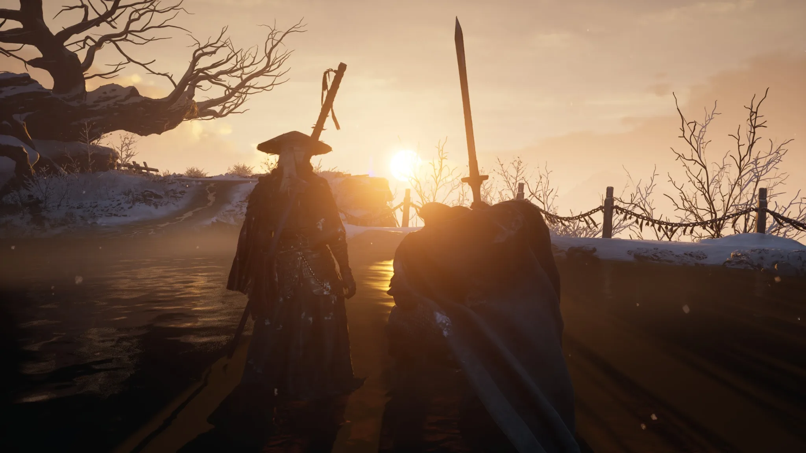

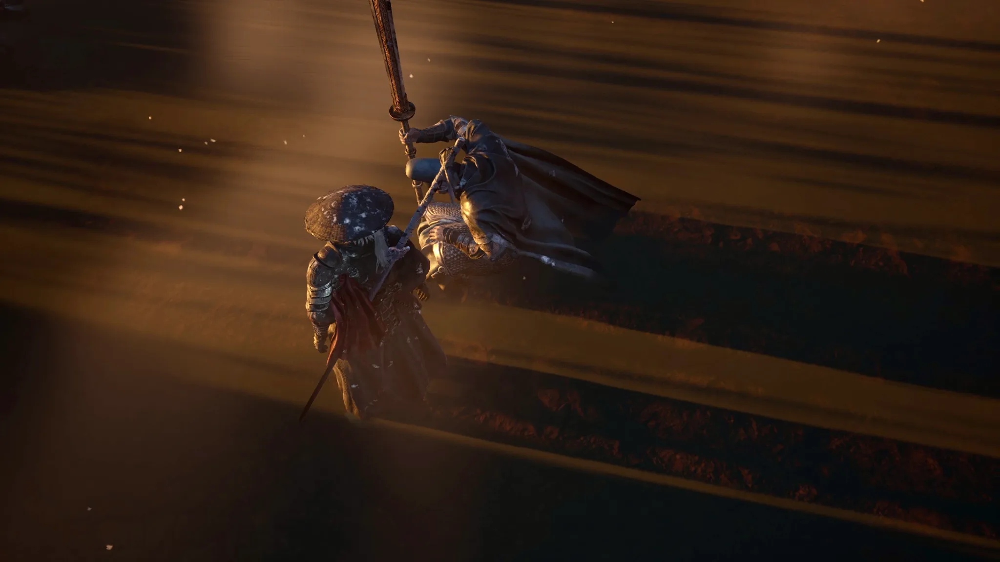

我当时是真的有点泪目。一个从前期就认识的鬼差，就这么一路走到了故事最后。他想要的，其实也就是能保住自己的意志而已。

还有「白山秘闻」这条线。这条任务的开头非常普通：血色森林飞贼营地附近的一座桥上，两个白山弟子小菊和兰兰在聊天，请你帮个小忙。谁能想到，这么个不起眼的委托，能一直延续到游戏中后期的阶段？

更难受的是，你后来再回到那里，会发现兰兰已经死了。小菊做了杀气改造，精神状态也不对了。她对着死去的同伴，居然还在质问对方为什么要自尽。但你明明知道发生了什么。游戏允许你直接戳穿她：「分明是你将她杀了！」然后你可以跟她动手，亲手结束这段悲剧。

如果你回来得很晚，情况还会更糟：曾经的飞贼营地已经陷入疯狂，熟悉的人也一个个失去理智。我很庆幸自己回去得够早，亲眼看到了那段对话。虽然后来还是被剧透了整个营地的结局，少了一些该有的震撼，但这条支线我还是忘不掉。

这种设计让我想到一些魂系和银河城游戏。你费心帮过的人、一点点建起来的据点，可能在某次回去的时候突然就变了。熟悉的地方变得陌生，友善的人也可能出事。我玩《空洞骑士：丝之歌》的时候，就因为自己辛辛苦苦帮着建起来的小镇被怪物毁了，气得不行，当时差点直接喊出来：「你都做了什么！」

《影之刃零》的这些支线也给了我类似的感觉。它先让你对一些人物产生感情，再让你亲眼看着他们的遭遇。而你有没有及时回来、有没有做完相关任务，有时还会改变你最后看到的故事。

这也是为什么我觉得它的支线特别有武侠味。江湖里人和人的关系，常常是不经意间就结下了，又可能因为一次分别、一次误会或者一场灾难，走向完全不同的结局。一个起初毫不起眼的小人物，可能在后面几十个小时里，慢慢变成你很在意的人。

沐小葵也是一个典型。从缎带里的童年回忆，到后来跟魂交手，再到杀气塔上重逢、雪山上分别，她实际出场的时间不算长，但每次出现都让我印象很深。

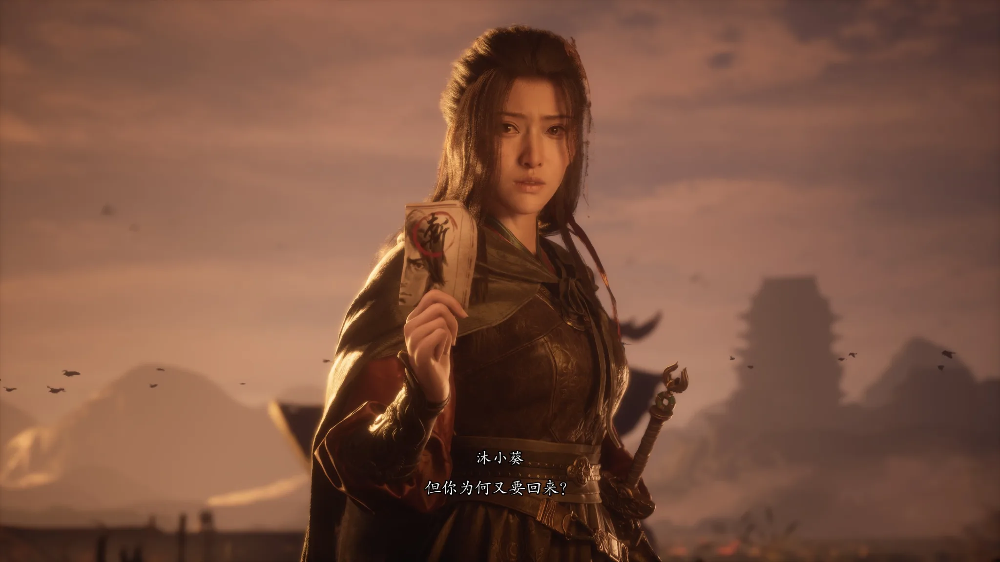

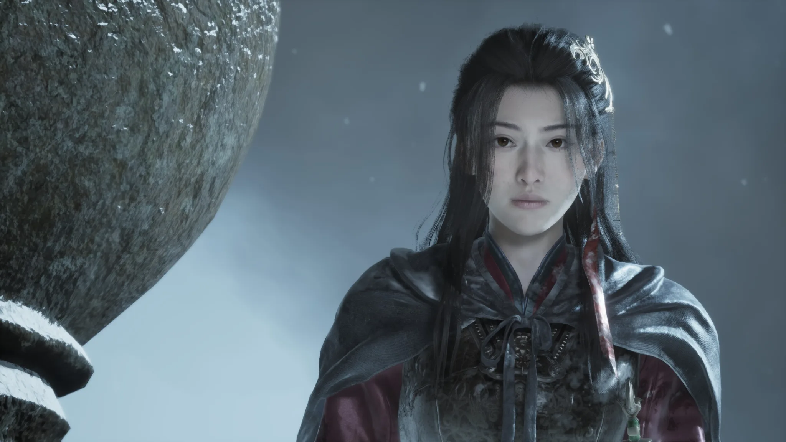

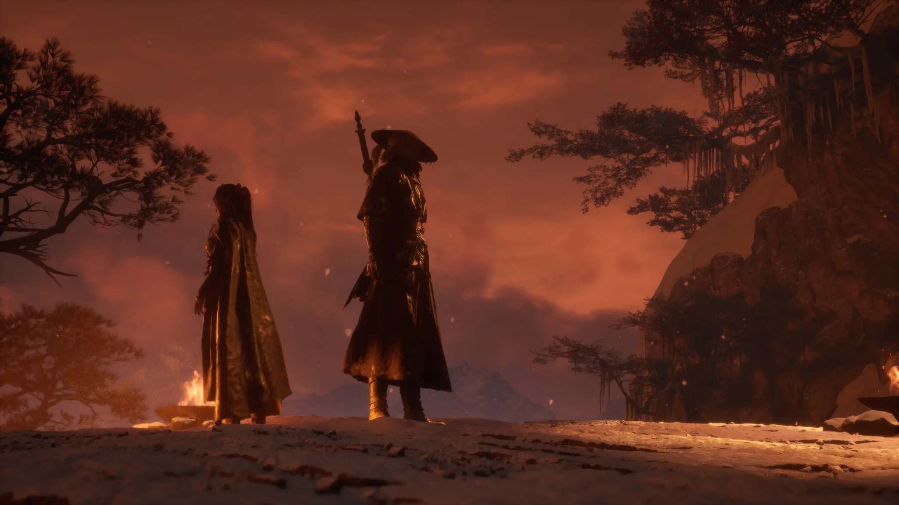

不过，少主离场的方式有时候也挺抽象的。第一次坐快艇走，我还能接受，毕竟这个世界本来就有不少工业科技。到了后来在雪山上，她直接用钩索挂上热气球飞走了。我当时确实有点绷不住。

但我还是很喜欢这个角色。除了她本身讨喜、Boss战精彩，还有个很重要的原因：她送我的乱莺剑，陪了我后面几十个小时。

这是只有游戏才能做到的人物塑造。一个角色可能只跟你相处了几十分钟，但他留下的一把武器，可能会陪你打完后面几十个小时的冒险。你每用一次这把武器，跟这个人物的联系就又续上一次。

这一点在玉妖和铁鬼的支线里做得更好。后来再碰到他们，对方希望你只带着他们给的武器，再跟他们切磋一次。当时我真觉得：就该这么设计！这才是武侠。江湖人之间不一定非要靠一大段台词交流感情，有时候一次切磋、一套剑法、一件兵器，就足够表达对彼此的认可了。

还有兰家大少、老根头、风雪刀客、玉儿父女，以及很多生活在这个世界里的普通人。他们的故事不一定多复杂，但各自都有各自的苦、选择和执念。魂一路上碰到这些人、帮这些人，也慢慢跟这个江湖连在了一起。

这些经历也让我对反派有了更直接的情绪。亲眼看着那些普通人因为阴谋、杀气改造和门派纷争遭殃，再去面对造成这一切的人，心里是真的会很愤怒。

玉儿遇害之后，我对火流星的愤怒就是这么来的。故事本身并不复杂，但它让我把自己的情绪带进了战斗里。对一款动作游戏来说，这已经很难得了。

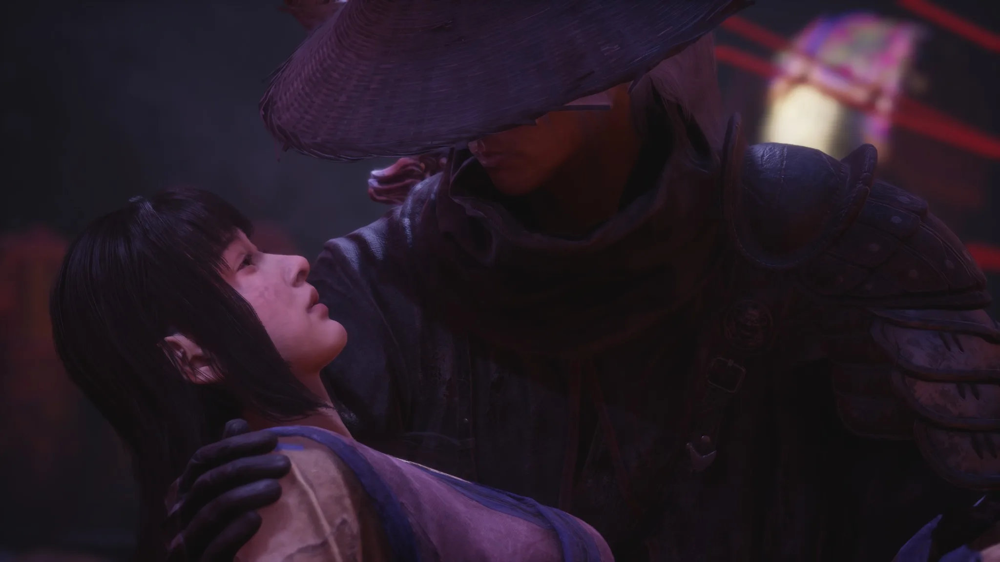

这也让我重新想了想游戏叙事这件事。我其实不太爱读游戏里的大段文本，记忆之花、背景资料、人物说明，我往往扫两眼就过去了，有些关键信息能记住，有些很容易就漏了。但如果一段故事需要我自己参与，去某个地方找人、做任务，或者通过对话、战斗和环境变化亲眼看着事情发展，我一般都会记得很清楚。《影之刃零》最让我投入的，恰恰就是这些需要自己去参与的故事。

我知道不少玩家觉得它剧情没代入感，也有人玩动作游戏基本不看剧情，每个人的体验自然不一样。但对我来说，它已经塑造出了一个让我愿意投入感情的江湖。考虑到它在人物表演、过场动画和整体制作资源上还有局限，我觉得制作组已经尽量在用场景、任务、配音和游戏机制，去补影视化叙事上的不足了，最后的效果挺不错的。

故事简单直接，也讲得够清楚。人物之间的恩怨、支线里的悲剧，再加上我亲身参与的那些经历，给了我很强的沉浸感。

到了最终决战前，旅途中碰到过、打败过、帮过的那些人，又出现在路两边给魂送行。那一段我挺感动的。尤其当我意识到，有些人之所以站在那里，是因为我真的做过他们的支线、参与过他们的人生，就更感动了。过去几十个小时里那些零零散散的探索和任务，好像终于有了回报。

我帮过这个江湖里的人，到最后，这个江湖也在给我回应。

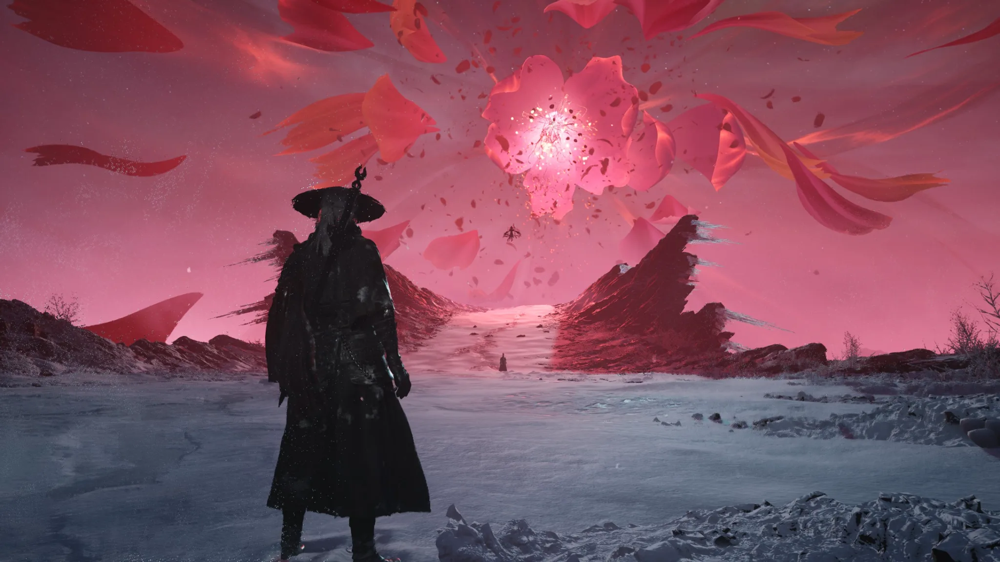

## 八、结语：成为大侠之后

《影之刃零》是一款挺特别的动作RPG。

它从传统高速ACT里拿来了华丽流畅的战斗表现，又靠RPG构筑和数值成长，大大降低了玩家体验这些东西的门槛。它借了魂系的箱庭地图和空间探索，又加上银河恶魔城式的能力解锁，并按自己的定位做了不少调整。它有非常丰富的武器流派、很有想象力的武侠朋克世界，还有大得惊人的内容量。

但它也不完美。后期战斗挑战跟不上玩家成长，部分Boss机制让人烦躁，一些探索交互太依赖脚本，主线故事也没把宏大的世界观发挥出来。更重要的是，在这么长的流程里，它很难一直保持前中期那种不断往上爬的兴奋感。

不过回头看，我还是愿意给它8分，因为它确实做成了一件我觉得很了不起的事。

很多动作游戏里，你得经过漫长的训练，最后才能成为高手。而《影之刃零》从一开始就在跟你说：你本来就是高手，你要做的，是去看看这个江湖到底有多大。

于是你拿起不同的兵器，来到陌生的地方，认识形形色色的人，跟各路高手切磋，看着他们的恩怨情仇，也慢慢有了属于自己的武学和经历。直到最后，那些曾经遇见过的人站在路两边给你送行，你才发现，自己已经真的走过了这片江湖。

我花了50个小时走完这趟旅程，确实有点长。

但如果有人问我，《影之刃零》有没有让我体验到当一个武林大侠的感觉？

有。而且这大概就是我一直想象中的那个江湖。

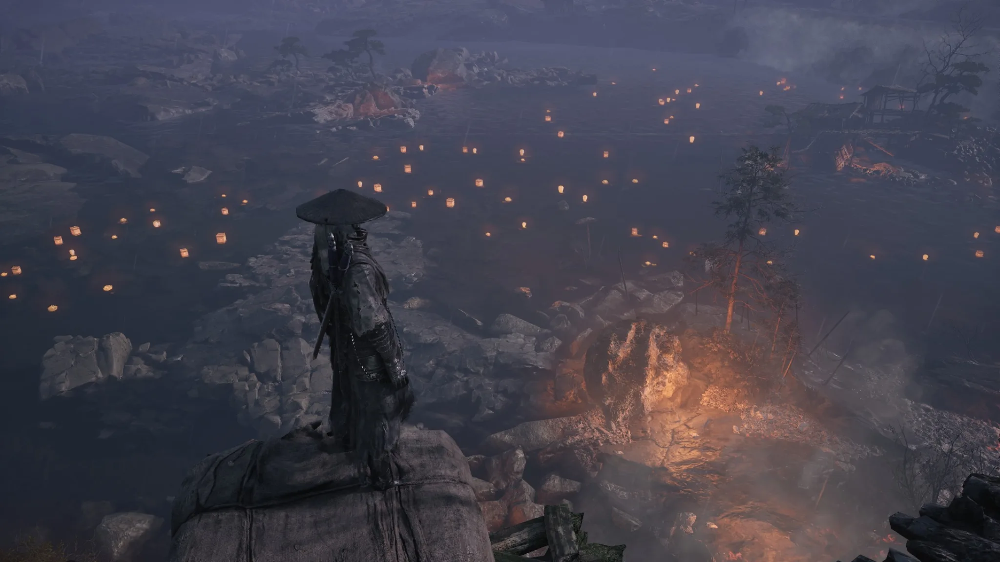
